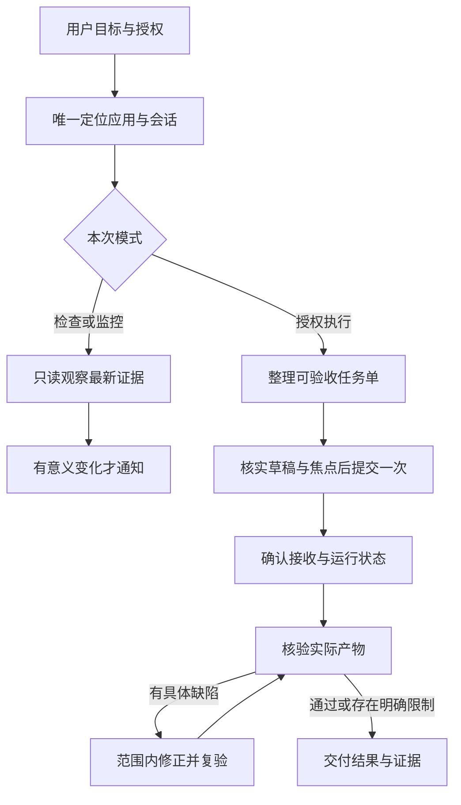

# DeepSeek Harness Control

让 Codex 在 Windows 上可靠地操作 **DeepSeek Harness（DSH）**：找到正确会话、下发已授权任务、检查进展，并用实际文件验收结果。

这是从桌面实操中整理的社区工作流 skill。它不捆绑 DeepSeek Harness、Computer Use 插件或 `@oai/sky`，也不是 DeepSeek 官方接口。

## 改进了什么

- **减少误操作**：唯一选窗，核对真实画面，输入前确认焦点；裁剪、白屏、弹窗或用户切换后重新观察。
- **避免重复任务**：分开记录“输入”“提交”“接受”“运行”“验收”。发送超时先查是否已接收，不盲重发。
- **让交付可信**：Harness 的“已完成”进入待验收阶段；检查实际产物和必要的独立证据，未知项如实保留。
- **监控保持安静**：状态不变不刷屏；同一异常只提醒一次。只读监控不代选、不发任务、不自动重启。
- **减少上下文浪费**：任务单替代长聊天转发，读取最新相关消息，修正时只发送具体失败证据。



## 使用条件

1. Windows 上已安装并可打开 DeepSeek Harness。
2. 当前 Codex 环境可使用 `computer-use:computer-use` 技能、`node_repl` 与 `@oai/sky`。
3. 用户已指定或上下文能唯一确定目标会话。执行模式还需要用户授权任务范围。

仅安装这个 skill 不会增加桌面控制权限。缺少上述能力时，它仍可协助整理任务和核查已授权文件，但不能直接操作 Harness。

## 安装

在具备技能安装器的 Codex 中输入：

```text
$skill-installer 从 https://github.com/emo-tao/deepseek-harness-control/tree/main/skills/deepseek-harness-control 安装这个 skill
```

也可将 `skills/deepseek-harness-control` 整个文件夹放入当前 Codex 版本支持的用户技能目录。目录规则与技能安装方式见 [OpenAI 官方技能文档](https://learn.chatgpt.com/docs/build-skills)。

## 调用示例

只读检查：

```text
使用 $deepseek-harness-control 检查 Harness 中“示例项目”会话，告诉我当前结果和需要我处理的问题，不发送消息。
```

继续执行：

```text
使用 $deepseek-harness-control 继续“示例项目”会话的导出修复。
只修改我指定的输出目录，保留原始工程。完成后独立检查字段、单位和输出文件。
```

持续监控：

```text
使用 $deepseek-harness-control 持续监控“示例项目”会话。
仅在完成、报错、需要我操作或无法继续观察时提醒；不要自动发消息或重启。
```

持续监控需要当前环境提供正式调度能力；skill 自身不是后台守护进程。

## 目录

```text
skills/deepseek-harness-control/
  SKILL.md                     触发范围、操作模式、提交与验收流程
  agents/openai.yaml           Codex 技能名称与默认调用提示
  references/sky-workflow.md   原生窗口、焦点、截图与恢复细节
  references/task-contract.md  任务单、提交记录与监控模板
docs/validation.md             检查结果与行为验收场景
```

**阅读入口**：[SKILL.md](skills/deepseek-harness-control/SKILL.md) · [验证说明](docs/validation.md)

发布包使用通用示例，不包含真实会话截图、运行日志、私人路径、论文、仿真数据或凭据。运行时产生的提交记录应保留在自己的项目中。

## English summary

A workflow skill for Codex to control DeepSeek Harness on Windows through an available Computer Use runtime. It separates read-only monitoring from authorized execution, verifies the target window and composer focus, prevents blind resubmission, and checks actual artifacts before reporting success. Runtime dependencies are supplied by the user's environment, not this repository.
